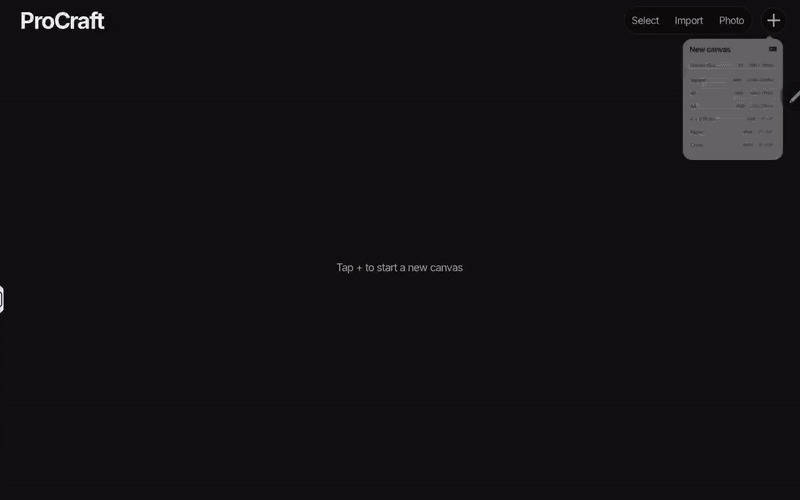
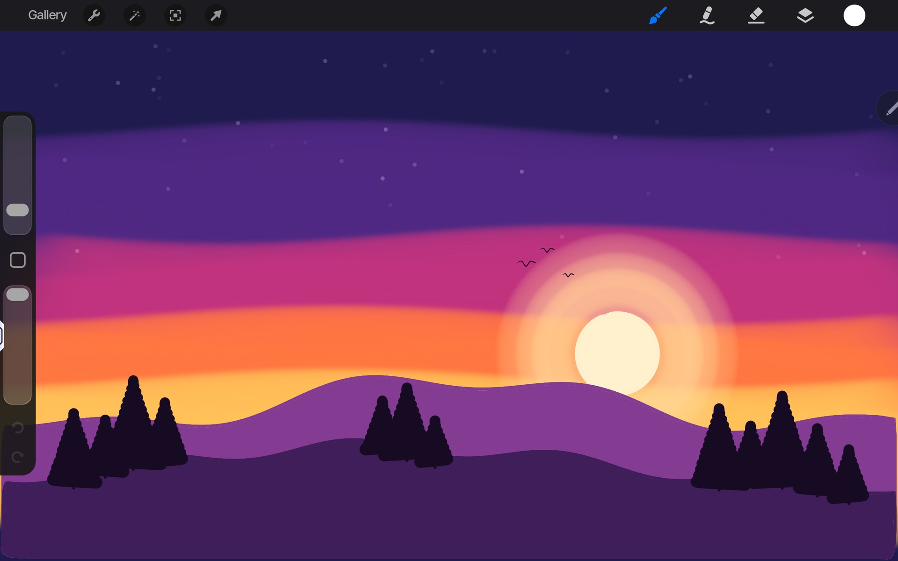
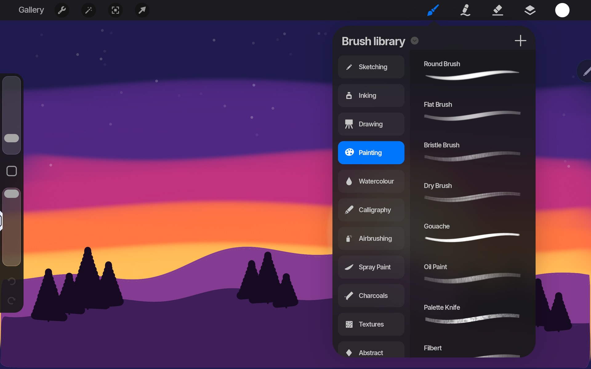
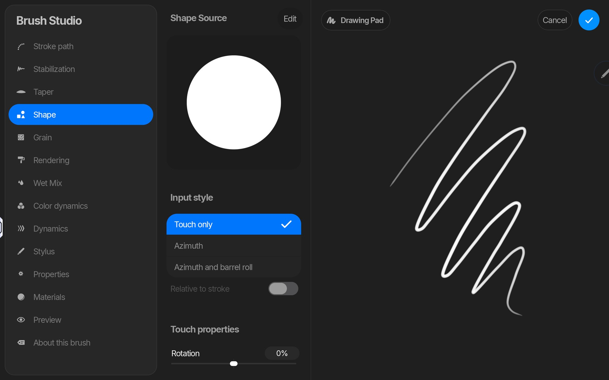
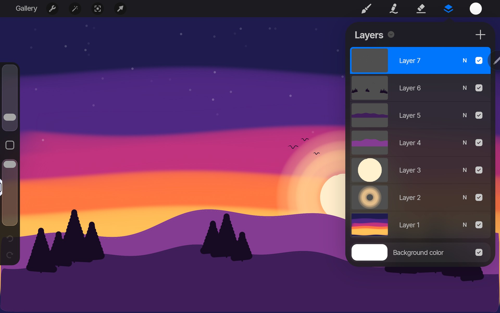
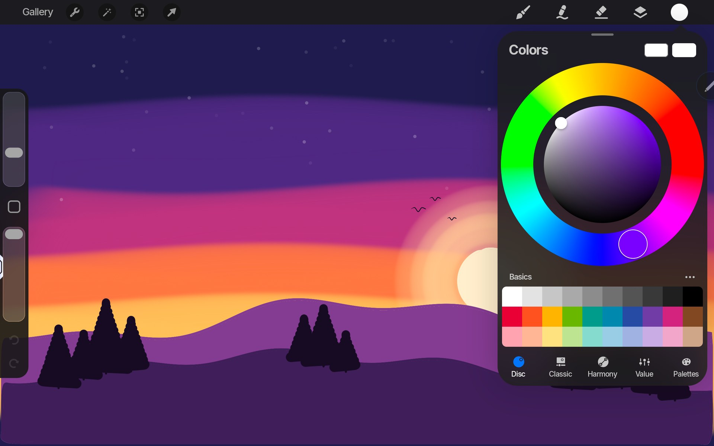
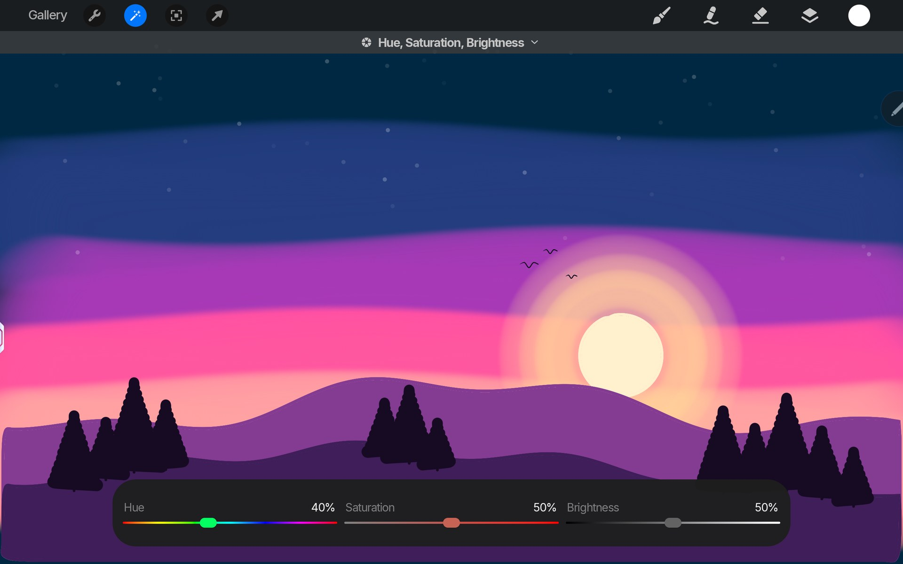
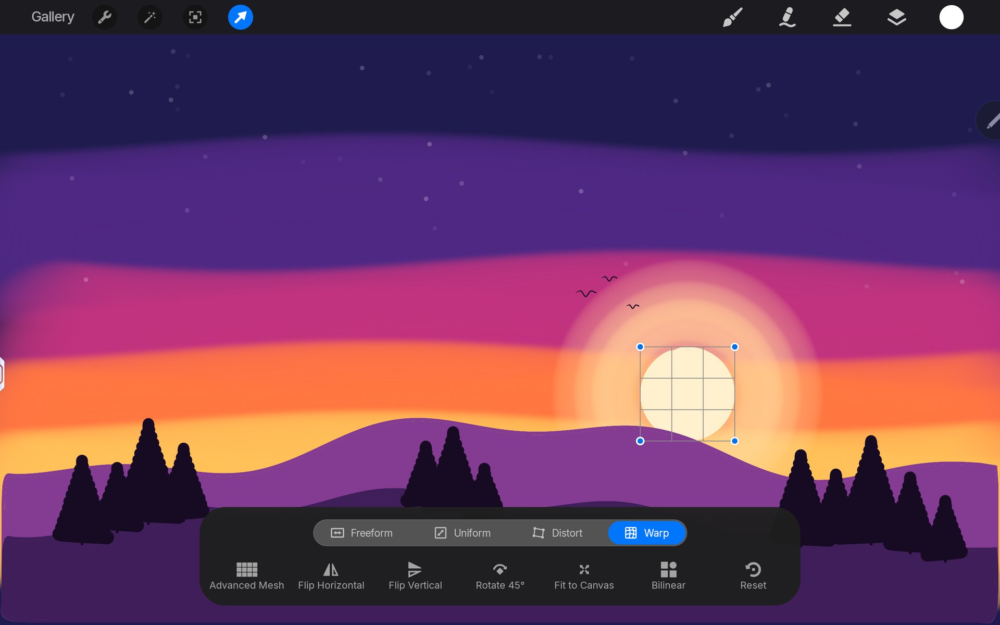
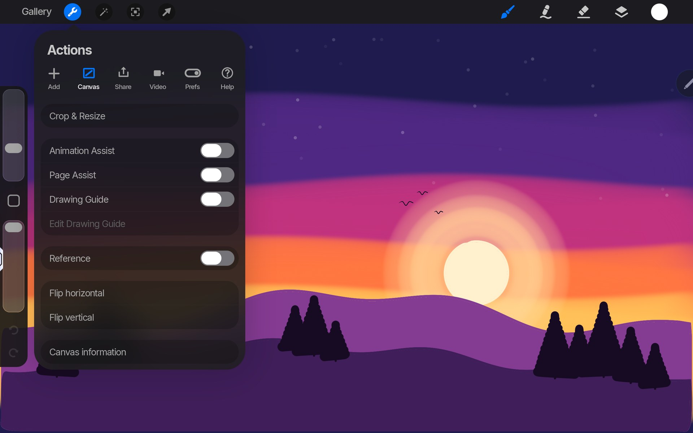

<p align="center">
  
</p>

<h1 align="center">ProCraft for Android</h1>

<p align="center">
  <b>An Android native open-source painting app for tablets, with its own Rust engine and GPU renderer under a Kotlin/Jetpack Compose UI.</b><br>
  Pressure-sensitive brushes, layers with blend modes, adjustments, selection and transform, animation and 3D painting, written from scratch.
</p>

<p align="center">
  <a href="https://github.com/artcraft-android/procraft-android/releases"></a>
  <a href="https://apps.obtainium.imranr.dev/redirect?r=obtainium://add/https://github.com/artcraft-android/procraft-android"></a>
</p>

<p align="center">
  
  
  
  
  
  
  
</p>

<p align="center">
  <a href="#painting">Painting</a> ·
  <a href="#layers-and-colour">Layers &amp; colour</a> ·
  <a href="#adjustments-and-transform">Adjustments &amp; transform</a> ·
  <a href="#actions">Actions</a> ·
  <a href="#planned-features">Planned features</a> ·
  <a href="#building-instructions">Building</a>
</p>

<br>

<p align="center">
  
  <br>
  <sub><b>Dusk</b>, painted from a blank canvas on a Lenovo Legion Tab: the sky filled and airbrushed, a sun snapped round and filled by dragging the colour in, hills filled the same way, pines inked, stars with Bloom. 4× playback with the idle pauses cut; <a href="docs/images/demo.mp4">full video</a> (2×). Every stroke is a pen stroke with pressure, played by the <a href="tools/showcase">demo script</a>.</sub>
</p>

<br>

<p align="center">
  
  <br>
  <sub>The canvas: the tools along the top, size and opacity in the sidebar, the whole screen for the painting.</sub>
</p>

<br>

## Painting

<table>
<tr>
<td width="50%"><br><sub>The brush library: eleven sets of our own brushes, each previewed with a stroke.</sub></td>
<td width="50%"><br><sub>The Brush Studio: stroke path, stabilization, taper, shape, grain, rendering, wet mix, colour dynamics and more, tried out on the drawing pad.</sub></td>
</tr>
</table>

<br>

## Layers and colour

<table>
<tr>
<td width="50%"><br><sub>Layers with blend modes, opacity, alpha lock, clipping masks, masks and groups. Layers past what the GPU holds are kept compressed, so artworks with hundreds of layers open and paint smoothly.</sub></td>
<td width="50%"><br><sub>Colour: disc, classic, harmony, value (with hex) and palettes.</sub></td>
</tr>
</table>

<br>

## Adjustments and transform

<table>
<tr>
<td width="50%"><br><sub>Hue, saturation, brightness on the sky layer, live. Also colour balance, curves, gradient map, blurs, noise, sharpen, bloom, glitch, halftone, chromatic aberration, liquify and clone, on the layer or painted on.</sub></td>
<td width="50%"><br><sub>Transform: freeform, uniform, distort and warp, with snapping. Selection: automatic, freehand, rectangle and ellipse, with feather.</sub></td>
</tr>
</table>

<br>

## Actions

<p align="center">
  
  <br>
  <sub>Actions: add files, photos and text; the canvas, its guides and assists; share as PNG, JPEG, PSD, PDF, TIFF, GIF or MP4; a time-lapse of every artwork; preferences and gesture controls.</sub>
</p>

<br>

## Planned features

ProCraft for Android is in beta.

| Area | Status |
|---|---|
| Canvas: the top bar, the sidebar (size, opacity, modify, undo, redo), full screen, gestures (pinch, rotate, quick fit, two- and three-finger taps, scrub to clear) | ✅ |
| Brush engine: shape and grain sources, stroke path, stabilization, taper, rendering and glazes, wet mix, colour dynamics, pen pressure and tilt; the library and the Brush Studio | ✅ |
| Layers: blend modes, opacity, alpha lock, clipping masks, masks, groups, merge, the reference layer; large artworks kept compressed off the GPU | ✅ |
| Colour: disc, classic, harmony, value and palettes; history; eyedropper; filling by dragging the colour onto the canvas | ✅ |
| Adjustments, each with its toolbar, on the layer or painted on | ✅ |
| Selection (automatic, freehand, shapes, feather) and transform (freeform, uniform, distort, warp, snapping) | ✅ |
| Shapes that snap clean, drawing guides and drawing assist (2D, isometric, perspective, symmetry), text | ✅ |
| Animation and page assists, the reference window | ✅ |
| Gallery: stacks, new-canvas presets, import and share (PNG, JPEG, PSD, PDF, TIFF, GIF, MP4), time-lapse | 🚧 nearly done |
| 3D painting: OBJ and USDZ models, texture sets, painting on the mesh, lights and environments | 🚧 |
| Phone layout | ⬜ |

<sub>✅ works today · 🚧 in progress · ⬜ not started · 🚫 not planned</sub>

<br>

## Building Instructions
*One Gradle command builds the whole app: it compiles the Rust engine with [cargo-ndk](https://github.com/bbqsrc/cargo-ndk) and generates the Kotlin bindings.*

* Clone this repository
* Make sure you have at least 6 GB of free disk space
* enter `apps/procraft-android/android` and run `./gradlew assembleRelease -Pprocraft.abis=arm64-v8a`, or open that folder in Android Studio and press Run.

Build time dependencies:

<details>
  <summary>required tools</summary>

  ```
      rustup, with the aarch64-linux-android and x86_64-linux-android targets
      cargo install cargo-ndk --version "^4" --locked
      Android SDK (API 37) and NDK 29.0.14206865
      JDK 17 or newer
  ```
</details>

`cargo test --workspace` runs the engine's and the renderer's tests on the desktop.

| Path | What |
|---|---|
| `crates/engine` | document, brushes, stroke geometry, canvas view (no GPU) |
| `crates/gpu` | wgpu renderer: layers, strokes, compositing, display |
| `apps/procraft-android` | the native library for Android (UniFFI bindings) |
| `apps/procraft-android/android` | the Android app (Gradle) |

*Builds are only tested on Windows 11.*

<br>

## License

[MIT](LICENSE-MIT) OR [Apache-2.0](LICENSE-APACHE), at your option. The third-party material the app
bundles (the Inter font, Lucide icons, light panoramas) and the libraries it is built with are listed
in [NOTICE](NOTICE); every asset, with its author, source and licence, in
[ATTRIBUTION.md](ATTRIBUTION.md).

Icons drawn using vector outlines ([`tools/icons/draw_icons.py`](tools/icons/draw_icons.py), to the
[style guide](docs/icons/STYLE_GUIDE.md)). The demo painting, *Dusk*, is our own, made in the app.

<br>

## Misc info for myself

Try to use [semantic commit](https://kapeli.com/cheat_sheets/Semantic_Commits.docset/Contents/Resources/Documents/index)
messages. Use `feat:` / `fix:` / `chore:` / `docs:` / etc.
