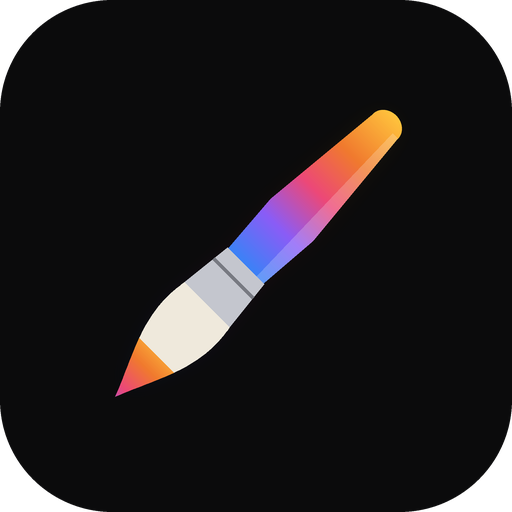

# ProCraft

A painting app for Android tablets, with a Rust engine and GPU renderer under a Kotlin / Jetpack
Compose interface.

**Status:** beta. Layers with blend modes, masks and groups; a brush engine with its studio and
library; colour, adjustments, selection and transform; text, animation, 3D painting; and opening
and sharing artworks, PSD, PDF, images and brushes.

## Layout

| Path | What |
|---|---|
| `crates/engine` | document, brushes, stroke geometry, canvas view (no GPU) |
| `crates/gpu` | wgpu renderer: layers, strokes, compositing, display |
| `apps/procraft-android` | the native library for Android (UniFFI bindings) |
| `apps/procraft-android/android` | the Android app (Gradle) |

## Building

```
cargo test --workspace
cd apps/procraft-android/android
./gradlew :app:assembleRelease -Pprocraft.abis=arm64-v8a
```

You need Rust with the Android targets, `cargo-ndk`, the Android SDK with NDK 29.0.14206865, and
JDK 17.

## Licence

[MIT](LICENSE-MIT) OR [Apache-2.0](LICENSE-APACHE), at your option. The third-party material the app
bundles (the Inter font, Phosphor and Lucide icons, light panoramas) and the libraries it is built with are listed
in [NOTICE](NOTICE); every asset, with its author, source and licence, in
[ATTRIBUTION.md](ATTRIBUTION.md).
